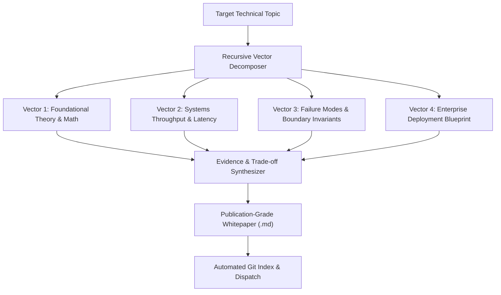

# Autonomous Deep Research Engine

[](https://github.com/Amz34/deep-research-engine/actions/workflows/ci.yml)
[](https://opensource.org/licenses/MIT)
[](https://github.com/Amz34/deep-research-engine/releases)
[](https://www.python.org/downloads/)
[](https://github.com/Amz34/awesome-agent-infrastructure)

Autonomous multi-angle technical research decomposition and publication-grade engineering whitepaper synthesis engine.


---

## Overview

The **Autonomous Deep Research Engine** decomposes complex systems engineering themes into discrete, non-overlapping architectural vectors. It investigates each vector through structured prompts, extracts asymptotic invariants and trade-offs, and synthesizes complete research whitepapers with Mermaid diagrams, comparative matrices, and enterprise deployment blueprints.

Part of the [Awesome Agent Infrastructure](https://github.com/Amz34/awesome-agent-infrastructure) ecosystem.

---

## Architectural Flow



---

## Features

- **Recursive Multi-Angle Decomposition**: Breaks technical inquiries into distinct architectural dimensions covering theory, performance constraints, failure modes, and enterprise production patterns.
- **Publication-Grade Dossiers**: Produces structured Markdown whitepapers complete with Mermaid topology diagrams, trade-off comparison tables, asymptotic complexity evaluations, and deployment blueprints.
- **Autonomous Signal Detection**: Inspects live engineering sources (including Hacker News and arXiv feeds) to discover emerging distributed systems and AI infrastructure themes.
- **Lightweight CLI & Automation**: Simple command-line interface with subcommands for targeted runs, trending detection, report indexing, and automated cron execution.

---

## Research & Engineering Benefits


1. **Systematic Invariant Analysis**: Avoids superficial high-level overviews by forcing in-depth evaluation across concrete systems constraints (latency, throughput, memory overhead, and network boundaries).
2. **Standardized Dossier Structure**: Generates consistent whitepaper layouts across all topics, ensuring executive abstracts, topology charts, and benchmark tables follow a uniform specification.
3. **Reproducible Local Execution**: Built on standard Python tooling with zero heavy machine learning framework dependencies on the client host.

---

## Quickstart

### Prerequisites

- Python 3.11 or 3.12
- Google Gemini API key (`GEMINI_API_KEY`)

### Installation

```bash
git clone https://github.com/Amz34/deep-research-engine.git
cd deep-research-engine
python3 -m pip install google-genai
```

### Usage

```bash
# Run deep research on any custom engineering topic:
python3 deep_research.py run "Speculative Tool Calling & Typed Decision Layers in Autonomous Agent Swarms"

# Run autonomous research on live trending systems topics:
python3 deep_research.py trending

# List all published whitepapers:
python3 deep_research.py list

# Rebuild README whitepaper index table:
python3 deep_research.py dashboard
```

---

## Testing

A comprehensive unit test suite validates topic decomposition, slug generation, whitepaper synthesis, and CLI indexing without requiring external API access.

```bash
# Run all unit tests
make test

# Run syntax linting across all modules
make lint
```

---

## 📂 Research Whitepaper Library

| Date | Whitepaper Title | Access Link |
|:---:|:---|:---:|
| `2026-11-08` | [Verifiable AI Agent State Integrity and Confidentiality via OpenTelemetry-Native Observability for Sovereign Air-Gapped Enterprise AI](./reports/2026-11-08-verifiable-agent-state-integrity-and-confidentiality-via-opentelemetry-native-observability-for-air-gapped-enterprise-ai.md) | [`Read Dossier →`](./reports/2026-11-08-verifiable-agent-state-integrity-and-confidentiality-via-opentelemetry-native-observability-for-air-gapped-enterprise-ai.md) |
| `2026-11-08` | [Enhancing Autonomous Agent Swarms: A Production-Grade Architecture for Speculative Tool Calling & Typed Decision Layers](./reports/2026-11-08-speculative-tool-calling-typed-decision-layers-in-autonomous-agent-swarms.md) | [`Read Dossier →`](./reports/2026-11-08-speculative-tool-calling-typed-decision-layers-in-autonomous-agent-swarms.md) |

---

## Limitations

- **API Rate Limits**: Remote model synthesis is subject to provider rate limits; the engine employs exponential backoff retry logic to handle rate-limiting transparently.
- **Hallucination Safeguards**: While the engine enforces structured trade-off matrices and citation sections, domain experts should review architectural assertions prior to production deployment.

---

## License

This project is licensed under the MIT License. See [LICENSE](LICENSE) for details.
