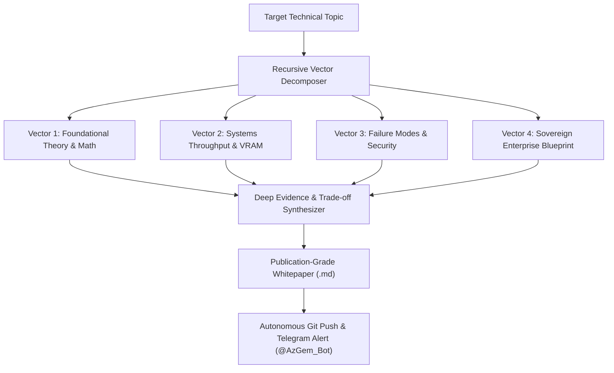

# ⚡ Autonomous Deep Research Engine

[](https://github.com/Amz34/deep-research-engine)
[](https://github.com/Amz34/deep-research-engine)
[](https://github.com/Amz34)
[](https://github.com/Amz34/deep-research-engine)

Recursive, multi-angle technical research decomposition and executive whitepaper synthesis engine architected by **[Aamir Zameer (@Amz34)](https://github.com/Amz34)** (Principal AI Systems Architect, Az. Consultancy).

---

## 🏛️ Architectural Overview



---

## 🚀 Key Capabilities

1. **Recursive Multi-Angle Decomposition**:
   - Breaks any engineering topic into non-overlapping architectural vectors (mathematical formulation, SRE constraints, security boundary invariants, and enterprise deployment).
2. **Enterprise Grade Dossiers**:
   - Every report includes **Mermaid architecture diagrams**, **trade-off benchmark matrices**, **asymptotic complexity proofs**, and **sovereign cloud compliance patterns**.
3. **Autonomous Daily Dispatch**:
   - Runs on schedule via cron at **10:00 UTC**, selects the #1 trending topic from the systems ontology, compiles the paper, commits to GitHub, and delivers an executive briefing to Telegram (`@AzGem_Bot`).

---

## 📂 Research Whitepaper Library

| Date | Whitepaper Title | Access Link |
|:---:|:---|:---:|
| `2026-11-08` | [Enhancing Autonomous Agent Swarms: A Production-Grade Architecture for Speculative Tool Calling & Typed Decision Layers](./reports/2026-11-08-speculative-tool-calling-typed-decision-layers-in-autonomous-agent-swarms.md) | [`Read Dossier →`](./reports/2026-11-08-speculative-tool-calling-typed-decision-layers-in-autonomous-agent-swarms.md) |

---

## 🛠️ CLI Usage

```bash
# Run deep research on any custom topic:
./deep_research.py run "Speculative Decoding in Multi-Agent Swarms"

# Run autonomous research on today's top trending enterprise theme:
./deep_research.py trending --push

# List all published whitepapers:
./deep_research.py list
```

---

*Architected & Maintained by [Aamir Zameer (@Amz34)](https://github.com/Amz34) · Principal AI Systems Architect at Az. Consultancy.*
